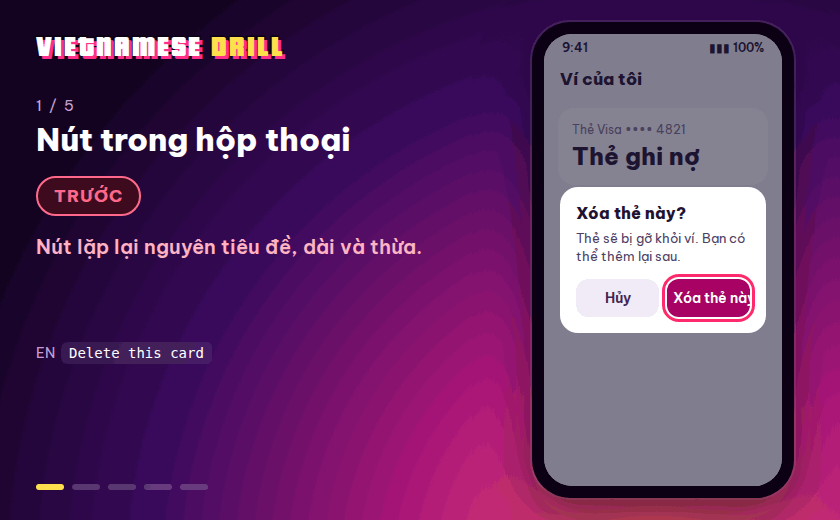
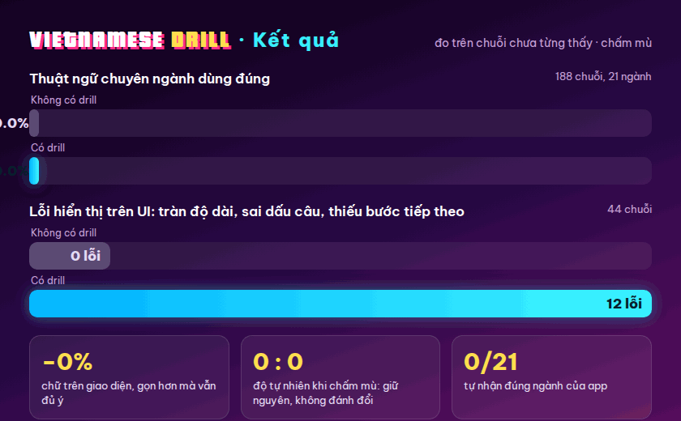
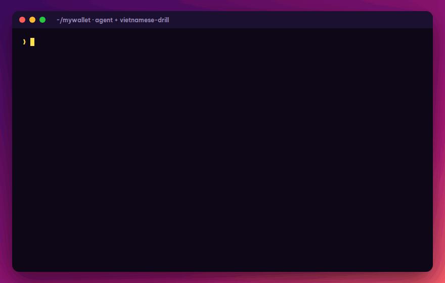
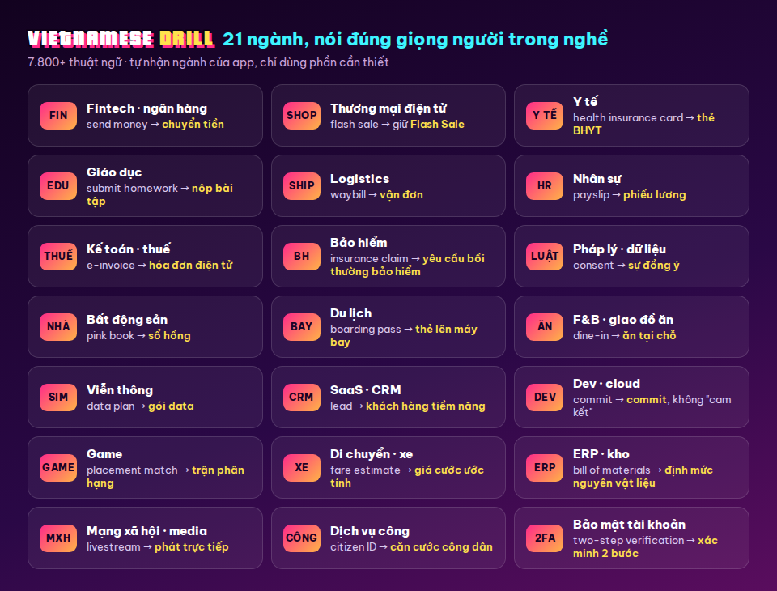
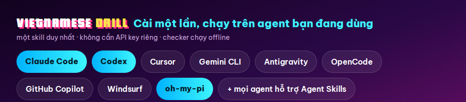

<div align="center">


# vietnamese-drill

**Cài một lần. Agent của bạn viết tiếng Việt như người làm sản phẩm thật.**

[](LICENSE)
[](skills/vietnamese)
[](#-21-ngành)
[](#)

**[Xem demo](#-trước-và-sau) · [Kết quả](#-kết-quả) · [21 ngành](#-21-ngành) · [Cài đặt](#-cài-1-lệnh) · [Nhờ agent](#-nhờ-agent-thế-nào)**

</div>

---

## 🎬 Trước và sau

<p align="center"></p>

Cùng một câu tiếng Anh, drill viết khác nhau tùy chỗ hiển thị: nút trong hộp thoại thì gọn, thông báo đẩy thì đủ ý, chữ trên nút luôn vừa khung. Thuật ngữ thì đúng giọng người trong ngành.

---

## 🏆 Kết quả

<p align="center"></p>

- **Thuật ngữ chuyên ngành đúng: 78,3% → 94,0%** trên 188 chuỗi thuộc 21 ngành.
- **Lỗi hiển thị trên UI: 12 → 0**: hết tràn khung, hết sai dấu câu, thông báo lỗi luôn có bước tiếp theo.
- **Gọn hơn 18%** mà vẫn đủ ý; **độ tự nhiên giữ nguyên** khi chấm mù (56 : 56).

| Câu gốc | ❌ Không có drill | ✅ Có drill |
|---|---|---|
| Delete this card *(nút trong hộp thoại "Xóa thẻ này?")* | Xóa thẻ này | Xóa |
| Top up your wallet now… *(nút tối đa 18 ký tự)* | Nạp tiền vào ví ngay để tiếp tục thanh toán hóa đơn tự động | Nạp tiền ngay |
| Payment failed *(thông báo đẩy)* | Thanh toán thất bại | Không thanh toán được 250.000 ₫ cho EVN Hà Nội do số dư không đủ. Nạp thêm tiền để thử lại. |
| Changes saved *(sau khi bấm Lưu)* | Thao tác lưu đã được thực hiện thành công! | Đã lưu |
| Send money *(ví điện tử)* | Gửi tiền | Chuyển tiền |
| Submit homework *(giáo dục)* | Gửi bài tập về nhà | Nộp bài tập về nhà |
| Commit your changes *(tài liệu dev)* | Cam kết các thay đổi | Commit các thay đổi |
| Failed to save image | Lưu hình ảnh thất bại. | Không lưu được hình ảnh. |
| Select All | Chọn Tất Cả | Chọn tất cả |

---

## ⌨️ Một câu nhờ, cả file chuẩn

<p align="center"></p>

Kết quả thật từ một lần chạy: agent tự đọc giới hạn trong README dự án, giữ nguyên `{amount}`, `{biller}`, `{code}`, nút vừa 15/18 ký tự, mô tả cửa hàng đúng 80/80. Chỗ không thể vừa thì nó nói thẳng: mã OTP cần 2 tin SMS.

---

## 🏭 21 ngành

<p align="center"></p>

Agent tự nhận app của bạn thuộc ngành nào. Dự án có bảng thuật ngữ riêng thì bảng đó luôn được ưu tiên.

---

## ⚡ Cài 1 lệnh

<p align="center"></p>

```bash
npx skills add zt-hky/vietnamese-drill
```

Lệnh này tự tìm các agent đang có trên máy và hỏi bạn muốn cài vào đâu. Cần Node.js 18 trở lên. Không cần API key riêng: drill dùng chính model agent đang chạy.

| Muốn | Lệnh |
|---|---|
| Cài cho tất cả agent mà CLI hỗ trợ, không hỏi (kể cả agent chưa cài) | `npx skills add zt-hky/vietnamese-drill -g --all` |
| Cài cho một agent | `npx skills add zt-hky/vietnamese-drill -g -a <mã agent>` |
| Cài riêng cho một dự án | bỏ `-g`, chạy trong thư mục dự án |
| Cập nhật · gỡ | `npx skills update` · `npx skills remove vietnamese` |

### Bản đầy đủ: thêm subagent review

| Agent | Lệnh |
|---|---|
| **Claude Code** | `claude plugin marketplace add zt-hky/vietnamese-drill` rồi `claude plugin install vietnamese-drill@vietnamese-drill` |
| **oh-my-pi** | `omp plugin install github:zt-hky/vietnamese-drill` (kèm rule, tool và subagent) |
| **Codex** | cài skill như bảng dưới, rồi copy [`codex/vietnamese_reviewer.toml`](codex/vietnamese_reviewer.toml) vào `~/.codex/agents/` |

Agent khác không cần subagent riêng: skill tự làm đủ các bước.

### Mã agent và thư mục cài tay

Không chạy được `npx`? Copy thư mục [`skills/vietnamese`](skills/vietnamese) vào thư mục bên dưới (`~` là thư mục home; cài riêng cho dự án thì dùng cột cuối, tính từ gốc repo).

**Agent dạng CLI**

| Agent | Mã `-a` | Cài cho mọi dự án | Cài cho một dự án |
|---|---|---|---|
| Claude Code | `claude-code` | `~/.claude/skills/` | `.claude/skills/` |
| Codex (OpenAI) | `codex` | `~/.agents/skills/` | `.agents/skills/` |
| Gemini CLI | `gemini-cli` | `~/.gemini/skills/` | `.agents/skills/` |
| Antigravity | `antigravity` | `~/.gemini/antigravity/skills/` | `.agents/skills/` |
| GitHub Copilot (CLI, VS Code) | `github-copilot` | `~/.copilot/skills/` | `.agents/skills/` |
| OpenCode | `opencode` | `~/.config/opencode/skills/` | `.agents/skills/` |
| Amp | `amp` | `~/.config/agents/skills/` | `.agents/skills/` |
| Goose | `goose` | `~/.config/goose/skills/` | `.goose/skills/` |
| Crush | `crush` | `~/.config/crush/skills/` | `.crush/skills/` |
| Droid (Factory) | `droid` | `~/.factory/skills/` | `.agents/skills/` |
| Warp | `warp` | `~/.agents/skills/` | `.agents/skills/` |
| Qwen Code | `qwen-code` | `~/.qwen/skills/` | `.qwen/skills/` |
| Kimi Code CLI | `kimi-code-cli` | `~/.agents/skills/` | `.agents/skills/` |
| Kiro CLI | `kiro-cli` | `~/.kiro/skills/` | `.kiro/skills/` |
| Devin for Terminal | `devin` | `~/.config/devin/skills/` | `.devin/skills/` |
| OpenHands | `openhands` | `~/.openhands/skills/` | `.openhands/skills/` |
| Mistral Vibe | `mistral-vibe` | `~/.vibe/skills/` | `.vibe/skills/` |
| Grok Build | `grok` | `~/.grok/skills/` | `.grok/skills/` |
| Rovo Dev (Atlassian) | `rovodev` | `~/.rovodev/skills/` | `.rovodev/skills/` |
| Tabnine CLI | `tabnine-cli` | `~/.tabnine/agent/skills/` | `.tabnine/agent/skills/` |
| oh-my-pi · Pi | `pi` | `~/.agents/skills/` | `.agents/skills/` |

**Agent trong IDE / editor**

| Agent | Mã `-a` | Cài cho mọi dự án | Cài cho một dự án |
|---|---|---|---|
| Cursor | `cursor` | `~/.cursor/skills/` | `.agents/skills/` |
| Windsurf | `windsurf` | `~/.codeium/windsurf/skills/` | `.windsurf/skills/` |
| Cline | `cline` | `~/.agents/skills/` | `.agents/skills/` |
| Roo Code | `roo` | `~/.roo/skills/` | `.roo/skills/` |
| Kilo Code | `kilo` | `~/.kilo/skills/` | `.agents/skills/` |
| Zed | `zed` | `~/.agents/skills/` | `.agents/skills/` |
| Trae · Trae CN | `trae` · `trae-cn` | `~/.trae/skills/` · `~/.trae-cn/skills/` | `.trae/skills/` |
| Junie (JetBrains) | `junie` | `~/.junie/skills/` | `.junie/skills/` |
| Augment | `augment` | `~/.augment/skills/` | `.augment/skills/` |
| Continue | `continue` | `~/.continue/skills/` | `.continue/skills/` |
| Qoder | `qoder` | `~/.qoder/skills/` | `.qoder/skills/` |
| Lingma (Alibaba) | `lingma` | `~/.lingma/skills/` | `.lingma/skills/` |
| CodeBuddy (Tencent) | `codebuddy` | `~/.codebuddy/skills/` | `.codebuddy/skills/` |
| Firebender (Android Studio) | `firebender` | `~/.firebender/skills/` | `.agents/skills/` |
| Zencoder | `zencoder` | `~/.zencoder/skills/` | `.zencoder/skills/` |
| Replit Agent | `replit` | `~/.config/agents/skills/` | `.agents/skills/` |

Danh sách đầy đủ hơn 70 agent: `npx skills add zt-hky/vietnamese-drill --list`, hoặc gõ `npx skills add zt-hky/vietnamese-drill` để chọn.

<details>
<summary>Agent không có trong danh sách</summary>

- Hỗ trợ chuẩn [Agent Skills](https://agentskills.io): copy thư mục `skills/vietnamese` vào thư mục skills của agent đó.
- Chưa hỗ trợ skill: dán nội dung `skills/vietnamese/SKILL.md` và `skills/vietnamese/modes/ui.md` vào file hướng dẫn của agent (`AGENTS.md`, `CLAUDE.md`, `.cursorrules`, `.github/copilot-instructions.md`…), và sửa đường dẫn `$SKILL_DIR` thành nơi bạn để thư mục skill.
</details>

<details>
<summary>Đang dùng bản 1.x?</summary>

Hai skill cũ đã gộp thành một. Gỡ bản cũ: `npx skills remove vietnamese-product vietnamese-replies`, rồi cài lại như trên.
</details>

---

## 💬 Nhờ agent thế nào

Cứ nói tự nhiên, drill tự bật khi cần:

```text
Dịch locales/en.json sang locales/vi.json cho app này.
Rà lại tiếng Việt trong màn hình thanh toán, nút tối đa 16 ký tự.
Viết thông báo đẩy khi đơn hàng giao thất bại.
Review file vi.json, app của mình là app bảo hiểm.
```

---

## 🛡️ Dữ liệu của bạn

Phần kiểm tra chạy hoàn toàn trên máy. Chỉ khi agent nhờ subagent review, các chuỗi mới đi tới model agent đang dùng; trước khi gửi, drill dặn bỏ secret và dữ liệu khách hàng.

---

## 🤝 Góp sức

Thấy thuật ngữ chưa đúng, hay ngành bạn chưa có? [Mở issue](https://github.com/zt-hky/vietnamese-drill/issues) kèm câu gốc, câu agent viết và câu bạn thấy đúng.

---

<details>
<summary>📼 Liner notes</summary>

Tham khảo và nguồn dữ liệu (kèm giấy phép): [`skills/vietnamese/references/sources.md`](skills/vietnamese/references/sources.md). Số liệu đo: [`evals/`](evals/).

Logo dùng font [Pricedown](https://typodermicfonts.com/pricedown/) (Typodermic, bản free cho thiết kế tĩnh), [Mr Dafoe](https://fonts.google.com/specimen/Mr+Dafoe) và [Be Vietnam Pro](https://fonts.google.com/specimen/Be+Vietnam+Pro) (SIL OFL). Không liên quan tới Rockstar Games hay GTA. License: [MIT](LICENSE).
</details>

<div align="center">

### 🎙️ Outro

*README này 100% do AI agent viết bằng chính skill `vietnamese`.*

**Peace out. Viết tiếng Việt cho có flow. ✌️**

</div>
